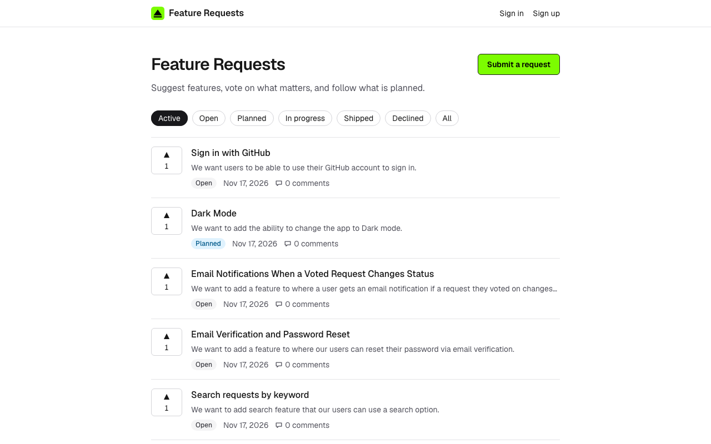
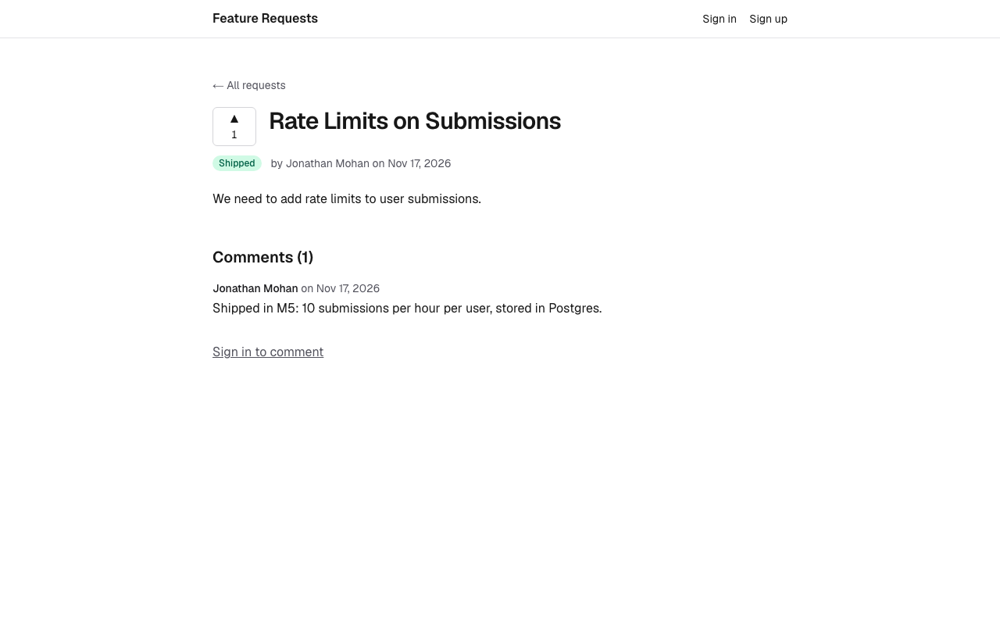
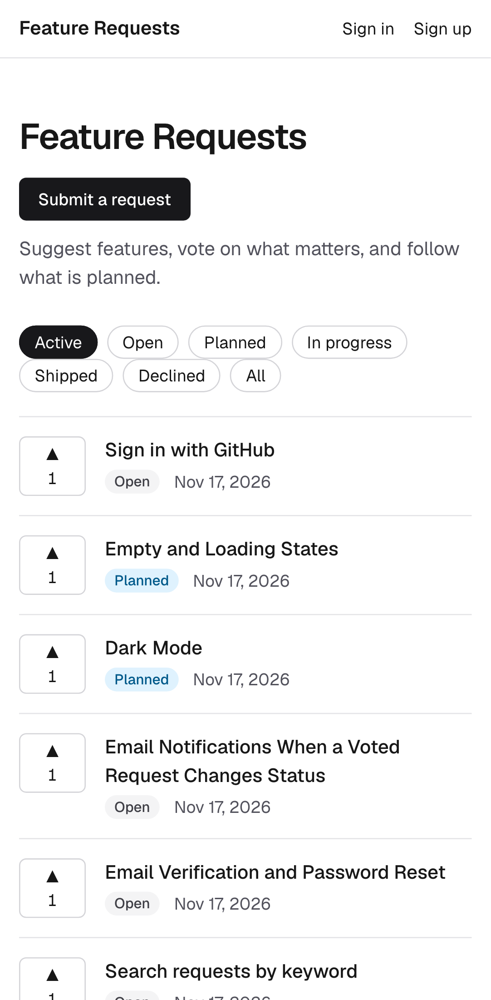
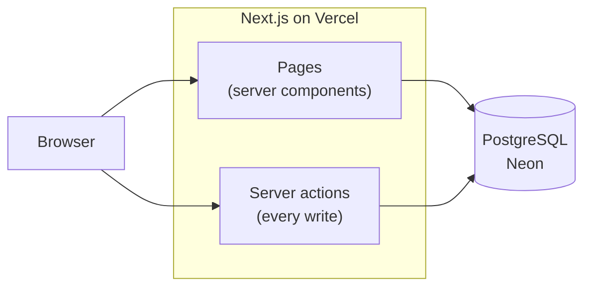

# Feature Request Tracker

A public board where people submit feature ideas, vote on them, comment, and follow each one from open to shipped.

A PM or product owner can use it to see what users want most and decide what goes on the roadmap next, or simply to gauge interest in a product's direction.

**Try it:** [feature-request-tracker.vercel.app](https://feature-request-tracker.vercel.app). Click **Sign in as the demo user** on the sign-in page, or sign up with any email address.



Next.js 16 · React 19 · TypeScript · PostgreSQL · Drizzle · Better Auth · Tailwind · Vitest · Playwright · Vercel · Neon

## What you can do

| Who                  | Can                                                                                                                    |
| -------------------- | ---------------------------------------------------------------------------------------------------------------------- |
| **A visitor**        | Browse the board, filter by status, read every request and its comments                                                |
| **A signed-in user** | Submit requests (your own vote is counted at once), vote and take a vote back, comment                                 |
| **The demo account** | Submit requests. It can't vote or comment: it's shared by everyone, so its votes and comments would be anonymous       |
| **An admin**         | Set any request's status, delete any request or comment. Admins are made with a script; there's no admin UI on purpose |

Voting closes when a request is shipped or declined. The votes it had stay counted.

<p>
  
  
</p>

## Architecture



Pages read data and render HTML on the server. Every write is a **server action**, and every server action is a public endpoint: anyone can send it a request without the UI. So each one checks everything itself, in the same order ([an example](src/app/requests/%5Bid%5D/admin-actions.ts)):

1. **Who is this?** The session, read from the database on every request, so a demoted admin loses access at once ([test](src/app/requests/%5Bid%5D/admin-session.int.test.ts)).
2. **Are they allowed?** Small, pure functions in [`permissions.ts`](src/lib/permissions.ts), one per action ([tests](src/lib/permissions.test.ts)).
3. **Is the input valid?** Anything can arrive, not only what the form sends: text, objects, numbers too big for Postgres.
4. **Under the rate limit?** Counted in Postgres, not in memory, because Vercel runs many short-lived servers ([`rate-limit.ts`](src/lib/rate-limit.ts)). Last, because it's the only step that uses something up.
5. **Save.**

Hiding a button is never the protection: the action refuses on its own. M6 included [a walkthrough](docs/specs/m6-voting.md) of sending a vote from the command line, without the UI, and seeing it refused.

## The data model

Four tables of my own ([`schema.ts`](src/db/schema.ts)) next to Better Auth's. The database enforces the rules that matter most itself, so a bug in the app can't break them:

| Rule                                                       | How                                                                                                     | Proof                                                                                                                  |
| ---------------------------------------------------------- | ------------------------------------------------------------------------------------------------------- | ---------------------------------------------------------------------------------------------------------------------- |
| One vote per user per request                              | The vote table's primary key is (request, user)                                                         | [`data-model.int.test.ts`](src/db/data-model.int.test.ts)                                                              |
| The demo account can never be an admin                     | A `CHECK` on the user table ([migration](drizzle/0002_user-role-rules.sql)), and the script refuses too | [`auth-roles.int.test.ts`](src/lib/auth-roles.int.test.ts), [`make-admin.int.test.ts`](src/lib/make-admin.int.test.ts) |
| A status is one of five                                    | A `CHECK` constraint, matched against the app's list by a test                                          | [`requests.int.test.ts`](src/lib/requests.int.test.ts)                                                                 |
| Deleting a request deletes its votes and comments          | `ON DELETE CASCADE`                                                                                     | [`admin-actions.int.test.ts`](src/app/requests/%5Bid%5D/admin-actions.int.test.ts)                                     |
| Titles, descriptions and comments aren't blank or too long | `CHECK` constraints, with the same limits checked in the app first for a friendly message               | [`data-model.int.test.ts`](src/db/data-model.int.test.ts)                                                              |

## Correctness when things happen at once

Three races were found and fixed along the way. Each test makes the race happen on purpose instead of hoping to hit it.

| The race                                                                                                                                                     | The fix                                                                                                                                           | Test                                                                          |
| ------------------------------------------------------------------------------------------------------------------------------------------------------------ | ------------------------------------------------------------------------------------------------------------------------------------------------- | ----------------------------------------------------------------------------- |
| **A double-clicked vote** could count twice, or cancel itself out                                                                                            | A click asks to **set** the vote (yes or no), never to flip it. "Yes" twice is still one vote                                                     | [20 votes at the same moment → 1](src/lib/votes.int.test.ts)                  |
| **A comment sent twice** (a double-click, a retry on a slow network) could post twice                                                                        | Each comment form carries a key chosen by the server; the database allows each key once per author                                                | [10 copies at the same moment → 1](src/lib/comments.int.test.ts)              |
| **A vote during a status change** could land on a request that was just shipped ([#14](https://github.com/JonathanPMohan/feature-request-tracker/issues/14)) | The vote checks the status and saves in one transaction, holding a lock on the request's row (`SELECT … FOR SHARE`). A status change waits for it | [A held status change, then a vote](src/app/requests/vote-action.int.test.ts) |

## Testing

| Layer           | Files           | What it proves                                                                                                                                           | Runs                                     |
| --------------- | --------------- | -------------------------------------------------------------------------------------------------------------------------------------------------------- | ---------------------------------------- |
| **Unit**        | `*.test.ts`     | Permission rules and validation, with no database                                                                                                        | Before every commit (a git hook), and CI |
| **Integration** | `*.int.test.ts` | Every server action called directly with any input, the database's rules, rate limits, races, password hashing and session expiry, against real Postgres | CI                                       |
| **End to end**  | [`e2e/`](e2e)   | The app in a real browser: [one request from idea to shipped](e2e/journey.spec.ts), on desktop and at phone width, plus every feature on its own         | CI, and against every Vercel deployment  |

- **Accessibility:** [axe checks](e2e/accessibility.spec.ts) run on the main pages in light and dark mode, and fail on serious problems. Automated checks catch only some problems, though. I tested the main path using only the keyboard (Tab, Enter, Space, the arrow keys, and Esc): browsing, signing in, submitting a request, voting, commenting, and the admin controls, including canceling and confirming deletes. Everything was reachable, with visible focus throughout.
- **Every deployment is tested,** previews and production. When Vercel finishes a deployment, [a workflow](.github/workflows/e2e-deployed.yml) runs the read-only end-to-end tests against it. Tests that create data never run against a real deployment.
- **Every change goes through a pull request.** `main` is protected, and CI must pass before a merge.

## How it was built

I built this with [Claude Code](https://claude.com/claude-code), one milestone at a time, each on its own branch and pull request. Before each milestone, a written spec listed its rules, its tests and the decisions to make; they're all in [`docs/specs/`](docs/specs), and [`docs/PLAN.md`](docs/PLAN.md) is the plan they came from.

## Who wrote what

I wrote the data model and migrations, the permission checks, and the authorization steps in every server action, learning with Claude as a tutor, and I made every product and design decision (each spec ends with mine).

Claude Code wrote the rest under specs I approved: the pages and components, the queries and rate-limit helper, most of the tests, the CI and deployment workflows, and most of this README. I reviewed all of it. The commits show this: most say `Co-Authored-By: Claude`.

## What I learned

I'm a product manager returning to hands-on development after about five years away. This project was how I got back in, and how I learned to build with AI without handing over the thinking.

- **Enforce rules where they can't be skipped.** A disabled button is a convenience. I proved it by sending a vote from the command line with the server check commented out, and it went through. The real rules live in the server and the database.
- **Concurrency bugs are real, even in small apps.** Double-clicks, simultaneous comments, and a vote arriving during a status change each needed a specific fix, and a test that proves it.
- **A test can pass for the wrong reason.** Several times, a test passed without testing anything real, and the fix was to check both the answer and the database.
- **Secrets leak through copies.** A test recording uploaded publicly contained a secret. Now I think about logs, recordings, and cookies, not just the obvious places.
- **Working with AI is a product skill.** Writing clear specs, making the decisions, reviewing everything, and asking "how do we know this works?" are the same skills I used as a PM, applied to code.

## Run it locally

You need Node.js and Docker. The full setup is in [`docs/LOCAL_DEVELOPMENT.md`](docs/LOCAL_DEVELOPMENT.md); in short:

```bash
npm install
cp .env.example .env          # then fill it in (see the guide)
docker compose up -d          # Postgres, with a dev and a test database
npm run db:migrate
npm run db:seed-demo
npm run dev                   # http://localhost:3000
```

`npm run make-admin <email>` makes an account an admin. Deployment, Neon and Vercel: [`docs/DEPLOYMENT.md`](docs/DEPLOYMENT.md).

## Known limitations

Left open on purpose, each with the reason it's acceptable for now:

- **No email verification or password reset** (v1 scope). Any email address works for sign-up.
- **Deployed test results don't appear on the pull request** ([#3](https://github.com/JonathanPMohan/feature-request-tracker/issues/3)). They run after Vercel deploys, outside the PR's checks, so they can't block a merge. A failure still shows in GitHub Actions, and CI's own end-to-end tests do block merges.
- **A deployment can occasionally go untested** ([#4](https://github.com/JonathanPMohan/feature-request-tracker/issues/4)) when a newer commit's deployment never arrives. The skip is never silent: it's flagged in the run.
- **The database connection strings aren't marked Sensitive in Vercel** ([#7](https://github.com/JonathanPMohan/feature-request-tracker/issues/7)). Only I have access to the Vercel project, and changing it means working around the Neon integration.
- **`npm audit` reports moderate warnings in dev tooling** ([#9](https://github.com/JonathanPMohan/feature-request-tracker/issues/9)). They're in tools that run on my machine and in CI, not in anything sent to a browser. One waits for a drizzle-kit release that drops an old dependency; npm's suggested `--force` fix would downgrade drizzle-kit instead. The other has a non-breaking update that hasn't been tried yet.

## License

[MIT](LICENSE)
